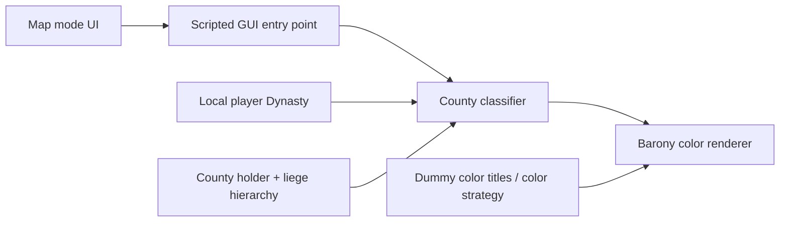
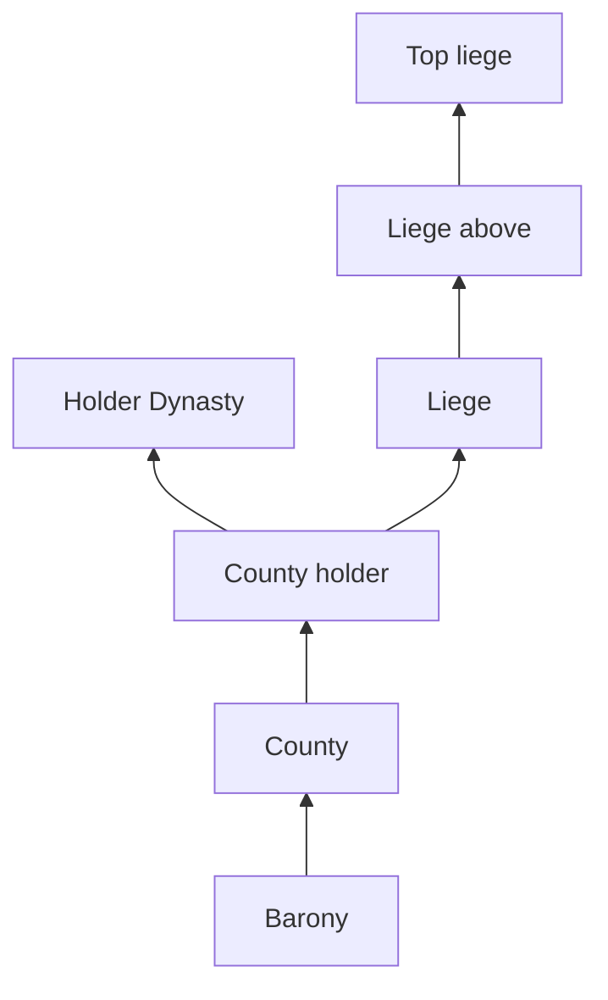

# Architecture

## Status

This document defines the intended architecture during M0 investigation of installed CK3 1.20.1.1 (Crozier). RESEARCH.md records VERIFIED generated script_docs signatures and scope links. Other API names, file paths and integration behavior remain candidates until supported by installed-file, generated-doc or runtime evidence. Open **Research Gates** still block the implementation decisions they cover.

## Logical components



### 1. Map mode definition

Expected location:

`gfx/map/map_modes/dynmap_map_modes.txt`

Installed 1.20.1.1 `game/gfx/map/map_modes/map_modes.txt:116–195` confirms
that the native `baronies` object uses `color_mode = baronies` (R-002). The
proposed custom object/path remains a candidate: separate-file loading, custom
selection and temporary rendering safety still require an authorized probe.

### 2. Scripted GUI / execution logic

Expected location:

`common/scripted_guis/dynmap_map_modes.txt`

Responsibilities:

- determine the current local player's Dynasty;
- execute a static refresh on valid activation/manual request;
- classify counties;
- apply colors to the county's baronies;
- fail safely if no local player or no Dynasty exists, starting in v0.1; v0.2 adds UX hardening and regression coverage.

Under ADR-008, My Dynasty is unavailable if there is no valid local player or the local player has no valid Dynasty. Activation in that state must perform no classification or color writes. An all-neutral map is not a substitute for unavailability.

If context becomes invalid while the mode is active, stop using the old Dynasty context and clear/restore visual state as far as the CK3 map-mode API permits. M0 must determine how to disable/hide the UI and detect context invalidation safely, including what cleanup/restore the API supports. Cleanup is distinct from unavailable activation and may require restoration writes; it must not classify against stale context.

### 3. Color sources

Expected location:

`common/landed_titles/dynmap_colors.txt`

For My Dynasty, use a small set of non-creatable dummy landed titles as color sources:

- `d_dynmap_direct`
- `d_dynmap_controlled`
- `d_dynmap_other`

Exact RGB values are intentionally deferred until in-game testing because lighting/terrain blending affects perceived contrast. CK3 1.20.1.1 script_docs verifies `set_title_color` on `landed_title` with named/RGB colors, and `set_color_from_title` from `landed_title` to `landed_title`. The latter deliberately shifts the copied color slightly; a shared source does not guarantee identical RGB values. This finding does not select a new color strategy. Persistence, restoration and map-only isolation remain UNKNOWN (see RESEARCH.md).

### 4. GUI integration

**Research Gate RG-UI-01**: R-002/R-003 statically inspected installed 1.20.1.1
map definitions and GUI. Native named blocks and explicit faith sub-mode buttons
exist, but separate-file insertion into the live HUD is unverified; the banner
instance overrides shared defaults. See RESEARCH.md. The gate remains open. The public custom-map-mode guide was last verified against a very old CK3 version, while the recorded patch references report sub-map-mode display changes in CK3 1.20. Verify the installed behavior during M0, including unavailable UI, re-click/manual refresh and exit/restore hooks.

Preferred order:

1. data-driven/additive integration without replacing a large vanilla GUI file;
   installed `gui/scripted_widgets/_scripted_widgets.info` documents additive
   startup registration (R-010). A separate original control is a candidate,
   not verified native-menu insertion; placement, loading and lifecycle still
   need an authorized probe. The user prefers a real child of the native map
   menu over an adjacent standalone widget. R-010 traced `mapmodes_insert_before`
   in Additional map modes as a candidate. The R-010 same-name type-extension
   probe crashed in recursive GUI type resolution on 2026-10-20 and is withdrawn.
   That route remains withdrawn. Probe 02 (original replacement of only the
   submenu type, based on primitive flowcontainer) now has startup and in-game
   DM-placement/tooltip evidence in 1.20.1.1. Full menu behavior, compatibility,
   unavailable state, refresh and cleanup remain unverified; it is not yet a
   production integration decision. No general load-order rule is established.
2. minimal scoped GUI override;
3. if neither approach is viable, record RG-UI-01 as blocked and document the evidence before revisiting the design.

ADR-006 prohibits vanilla files in Git. A full `mapmodes.gui` copy is therefore not an authorized fallback. Do not copy or modify vanilla files; inspect them read-only. Any future proposal to change this policy requires an explicit ADR revision and authorization before proceeding.

## Domain model

### Entity relationships relevant to My Dynasty



The design models the ordinary de-facto political hierarchy as a rooted forest with one liege per ruler. Generated script_docs for 1.20.1.1 verifies `landed_title.holder` -> `character`, `character.dynasty` -> `dynasty`, `character.house` -> `dynasty_house`, and `dynasty_house.house_dynasty` -> `dynasty`. The `county` and `barony` links accept `landed_title` or `province` and return `landed_title`. `any_liege_or_above` accepts a character and iterates character lieges above it, excluding self. Thus DIRECT must be checked separately before CONTROLLED traversal. Government-specific runtime behavior remains untested; prefer this documented traversal over materializing a graph. Exact log locations are in RESEARCH.md.

## My Dynasty classification

Let `PD` be the valid local player's Dynasty and `H` the county holder. This is conceptual pseudocode, not verified CK3 syntax.

```text
if local player or PD is invalid:
    mode unavailable; return without classification or color writes
else if H exists and H has a valid Dynasty and H.dynasty == PD:
    DIRECT
else if H exists and a qualifying de-facto liege has dynasty == PD:
    CONTROLLED
else:
    OTHER
```

Important semantics:

- cadet Houses automatically collapse because comparison is on `dynasty`;
- county holder controls classification, not barony holder;
- a holder without a Dynasty cannot be DIRECT, but can be CONTROLLED through a qualifying liege; check the chain before assigning OTHER;
- occupations do not change classification in v1.0;
- tributary/suzerain relations do not count as lieges in v1.0;
- regents/co-rulers do not replace the legal title holder for classification.

## State management

### Principle: avoid persistent state in MVP

Older custom map-mode examples multiplex one renderer using global variables. That creates save-state, observer-mode and multiplayer concerns. For the first implementation, prefer one named map-mode definition per logical mode and derive button state from `IsMapMode(...)` if CK3 1.20+ allows it.

Do not introduce persistent cache variables unless profiling demonstrates a measurable need.

## Refresh model

### v0.1–v0.2: static/on-demand

- valid activation executes a full classification/color pass;
- v0.1 requires a dependable refresh path: re-click only if verified by M0; otherwise use the smallest explicit refresh mechanism needed;
- revalidate local player/Dynasty on activation and refresh; never reuse stale context;
- invalid context while active stops old-context use and triggers API-supported clear/restore; verify lifecycle hooks during M0 without recurring world scans;
- no daily/monthly pulse or title-change listeners for world recomputation; minimal context-safety lifecycle handling is required;
- exiting restores normal map visuals as supported and verified against the target API.

### Post-0.2 options

Only after profiling and correctness testing:

- event-driven invalidation/refresh on title-holder or vassal-hierarchy changes;
- limited periodic refresh while the mode is visible.

Incremental caching is deliberately postponed because invalidation is harder than recomputation for a shallow hierarchy.

## All Dynasties architecture

All Dynasties remains behind a research gate. Generated script_docs verifies `every_dynasty_house` and `any_dynasty_house` from `dynasty` to `dynasty_house`; these expose membership, not the native House color source or a grouping/classification callback. Those capabilities remain UNKNOWN.

Desired logical key:

`territorial ruler -> House -> Dynasty -> shared color`

Candidate color strategies, in preferred research order:

1. **Reuse native House-map internals** if CK3 exposes a grouping/color hook.
2. **Dynasty-head primary-title color** as a stable-enough source for all counties of the Dynasty.
3. **Main/founding House-derived color** if exposed by current GUI/script APIs.
4. **Deterministic palette allocation** only if a stable Dynasty identity can be mapped without persistent save-state.
5. Persistent color registry as a last resort.

No All Dynasties implementation should be merged until the color strategy has explicit stability, collision and save-state behavior documented.

## Naming conventions

- All custom script IDs: `dynmap_*`
- All localization keys: `dynmap_*`
- All dummy titles: `d_dynmap_*`
- Future event namespace: `dynmap`
- Files owned by this project should start with `dynmap_` where CK3 loading rules permit it.
