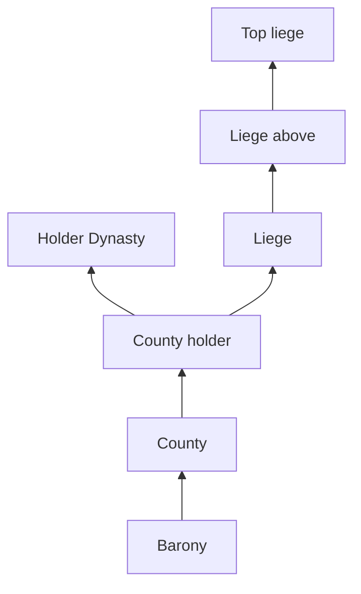

# Architecture

## Status

This document defines the intended architecture during M0. R-016 now targets installed CK3 1.20.1.2 (Crozier); earlier evidence retains its 1.20.1.1 provenance. RESEARCH.md records VERIFIED generated script_docs signatures and scope links. Other API names, file paths and integration behavior remain candidates until supported by installed-file, generated-doc or runtime evidence. Open **Research Gates** still block the implementation decisions they cover.

## Logical components

### 1. Map mode definition

Expected location:

`gfx/map/map_modes/dynmap_map_modes.txt`

Installed 1.20.1.1 `game/gfx/map/map_modes/map_modes.txt:116–195` confirms
that the native `baronies` object uses `color_mode = baronies` (R-002). The
R-009 user-run batch supports two original custom objects loaded from a separate
file and selected with this native producer. This is bounded evidence for those
definitions; temporary rendering safety is unresolved and changed title colors
are shared with native baronies.

### 2. Scripted GUI / execution logic

Expected location:

`common/scripted_guis/dynmap_map_modes.txt`

Responsibilities:

- determine the current local player's Dynasty;
- execute a static refresh on valid activation/manual request;
- classify counties;
- apply colors to the county's baronies;
- fail safely if no local player or no Dynasty exists, starting in v0.1; v0.2 adds UX hardening and regression coverage.

Under ADR-008, My Dynasty is unavailable if there is no valid local player or the local player has no valid Dynasty. Activation in that state must perform no classification or color writes. An all-neutral map is not a substitute for unavailability.

If context becomes invalid while the mode is active, stop using the old Dynasty context and clear/restore visual state as far as the CK3 map-mode API permits. M0 must determine how to disable/hide the UI and detect context invalidation safely, including what cleanup/restore the API supports. Cleanup is distinct from unavailable activation and may require restoration writes; it must not classify against stale context.

#### R-005 evidence boundary (2026-10-20)

Explicit fresh player roots, manual-switch/succession notifications and a
separate GUI observer-validity watcher have runtime diagnostic evidence.
Character-change hook delivery did not cover tested observer/load transitions;
GUI VariableSystem state is not guaranteed to reset on in-process reload.
Direct character-scoped Execute with a null root logged a validation error even
with conditional root guards, before any effect ran. Do not treat internal
validation as an error-free missing-player entry boundary. FINAL GUARDS A passed
for the tested displayed path into observer after RESET: NO PLAYER appeared,
action buttons were absent, and the bounded capture contained no extra activation
or probe-attributed validation error. This is external UI evidence for that
transition, not direct invalid-root or every-race safety. The same run rejected
the one-shot `set_to_lowborn` player fixture; no-Dynasty local-player UI remains
unverified and is deferred to [R-013 / #13](https://github.com/mhaduk/ck3-dynasty-map/issues/13). ADR-008 semantics remain unchanged.
GUI flag invalidation is not title-color restoration. See the [R-005 checkpoint](tasks/R-005-player-context.md).

### 3. Color sources and renderer input — unresolved

The historical dummy-title palette candidate proposed three non-creatable source
titles in `common/landed_titles/dynmap_colors.txt`. R-009 tested four fixed
research sources, not a production palette or one title per barony. Search
visibility and CoA/capital errors leave inertness unresolved. Do not implement
F-102 or add more titles before the color strategy is resolved.

Generated `set_title_color` accepts named/RGB values; `set_color_from_title`
introduces a deliberate slight shift. Direct/named writes avoid dummy sources
but still mutate title state. R-009 confirmed native/custom barony views share
those mutations and designated AFTER saves serialize explicit title RGB.
Definition resets do not recover arbitrary live originals; exact capture,
automatic cleanup and disabled-mod/fresh-process behavior remain open.

Current research separates a conceptual ephemeral barony -> county class
(dark/light/grey for the selected ADR-010 view) mapping from a three-category
palette. It preserves ADR-008 unavailability. R016 has a prepared three-view
research classifier and bounded startup/execution evidence; no production
classifier, saved palette registry or verified isolated storage API is
established.

The missing link is a supported consumer of that mapping only in our view.
Native mode definitions select engine producers. The exposed overlay shader
samples engine-bound province color textures; no generic script/GUI table upload
or grouping callback was identified in the reviewed surface. Metadata/selection
bindings and variables alone do not establish that link. Native Realms, Houses
and Faith/Rite grouping cannot substitute for the required classifier.

Situation sub-region/group `map_color` and membership are a documented
specialized consumer. The bounded feasibility trace found installed add/remove
usage with individual county titles and a native sub-region color mode. It also
found a world-Situation lifecycle and game-view selection by object ID, not a
demonstrated local ephemeral buffer or independent named-map binding. Both
automatic enrollment paths can be disabled and authored gameplay hooks omitted;
zero-participant rendering, exact county/barony coverage, competing Situation
selection, saved/shared behavior and exit/removal safety remain unverified.
The route remains unevaluated for production pending those unknowns; this is
not approval or static disproof. The user has not rejected persistent state in
general; the concern is repurposing unrelated titles or Situations as fragile
map workarounds. Shared shader recoloring also lacks a demonstrated dynamic
classification input/view gate.
See the [R-009 trace](tasks/R-009-barony-color-safety.md#native-color-data-trace--static-evidence)
and [RESEARCH.md](RESEARCH.md#r-009-native-color-data-and-renderer-boundary).
No strategy or ADR semantics are changed; implementation stays gated.

### 4. GUI integration

**Research Gate RG-UI-01**: R-002/R-003 statically inspected installed 1.20.1.1
map definitions and GUI. Native named blocks and explicit faith sub-mode buttons
exist, but separate-file insertion into the live HUD is unverified; the banner
instance overrides shared defaults. See RESEARCH.md. The gate remains open. The public custom-map-mode guide was last verified against a very old CK3 version, while the recorded patch references report sub-map-mode display changes in CK3 1.20. Verify the installed behavior during M0, including unavailable UI, re-click/manual refresh and exit/restore hooks.

Preferred order:

1. data-driven/additive integration without replacing a large vanilla GUI file;
   installed `gui/scripted_widgets/_scripted_widgets.info` documents additive
   startup registration (R-010). A separate original control is a candidate,
   not verified native-menu insertion; placement, loading and lifecycle still
   need an authorized probe. The user prefers a real child of the native map
   menu over an adjacent standalone widget. R-010 traced `mapmodes_insert_before`
   in Additional map modes as a candidate. The R-010 same-name type-extension
   probe crashed in recursive GUI type resolution on 2026-10-20 and is withdrawn.
   That route remains withdrawn. Probe 02 (original replacement of only the
   submenu type, based on primitive flowcontainer) now has startup and in-game
   DM-placement/tooltip evidence in 1.20.1.1. Full menu behavior, compatibility,
   unavailable state, refresh and cleanup remain unverified; it is not yet a
   production integration decision. No general load-order rule is established.
2. minimal scoped GUI override;
3. if neither approach is viable, record RG-UI-01 as blocked and document the evidence before revisiting the design.

ADR-006 prohibits vanilla files in Git. A full `mapmodes.gui` copy is therefore not an authorized fallback. Do not copy or modify vanilla files; inspect them read-only. Any future proposal to change this policy requires an explicit ADR revision and authorization before proceeding.

## Domain model

### Entity relationships relevant to My Dynasty

The design models the ordinary de-facto political hierarchy as a rooted forest with one liege per ruler. Generated script_docs for 1.20.1.1 verifies `landed_title.holder` -> `character`, `character.dynasty` -> `dynasty`, `character.house` -> `dynasty_house`, and `dynasty_house.house_dynasty` -> `dynasty`. The `county` and `barony` links accept `landed_title` or `province` and return `landed_title`. `any_liege_or_above` accepts a character and iterates character lieges above it, excluding self. Thus DIRECT must be checked separately before CONTROLLED traversal. Government-specific runtime behavior remains untested; prefer this documented traversal over materializing a graph. Exact log locations are in RESEARCH.md.

## My Dynasty classification

ADR-010 defines one Dynasty family with three ordered views, initially Dynasty
Realms. For fresh valid player P and Dynasty D, classify county holder H and
all ordinary de-facto seniors S; T is the highest ruler, or H when independent.

| View | Dark green | Otherwise light green |
|---|---|---|
| Dynasty Realms | T's Dynasty is D | H or any senior has D |
| Dynasty Holdings | H's Dynasty is D | Any senior has D |
| My Realm & Dynasty | H is P or P is any senior | H or any senior has D |

Otherwise grey; an unheld county is grey. Invalid P/D makes the feature
unavailable without classification or writes. Dark precedes light. Cadet Houses
compare Dynasty, not House. Missing holder Dynasty never skips senior checks.
Player-vassal dark territory is only P's subtree, never all of P's top ruler's
realm. Baron identity, occupation, claims, regents/co-rulers and tributary/
suzerain relationships do not replace the legal holder or de-facto hierarchy.
De-jure membership is used only to propagate the county result to its baronies.
Historical DIRECT/CONTROLLED/OTHER denotes Holdings, not the default Realms rule.

The R016 source revision for 1.20.1.2 prepared all three direct classifiers,
one Dynasty menu entry and an associated active-map panel with selection and
legends. Startup and bounded repeated executions were observed; the user
reports ordinary switching/refresh/native-return smoke appears to work. Grey
nonmatching land failed visual acceptance, and the smoke does not establish
full semantic coverage, atomicity, performance or lifecycle safety. Startup
loaded the new GUI assets; user observation showed the ordered controls and
legend at two zoom levels, not all UI scales or compatibility contexts. The
original Additional Modes seam and narrow banner composition are intentional
native type overrides; native children remain references. The custom panel
sits outside the HUD-overridden native submode block. No vanilla body/HUD file
is packaged. The old R010 Faith smoke does not validate this new panel.

Normal entry/subview/refresh calls Execute with fresh GetPlayer, then SetMapMode.
UI availability queries Dynasty; the effect checks it again before any pass.
The composed call is only a candidate: void Execute cannot report success or
make dispatch/display atomic during a context change. Explicit per-view
COMPUTE/log review/DISPLAY diagnostics remain available. They do not complete
the normal UX requirement or close ADR-008. Each subview recomputes rather than
showing another subview's last-painted RGB. Additional-menu opening does not
scan; re-entering through Dynasty resets to Realms, while an active alternative
stays selected until an explicit selection. Shared RGB, context-loss cleanup,
exit/restore, persistence/removal and full coverage remain unresolved.

## State management

### Principle: avoid persistent state in MVP

Older custom map-mode examples multiplex one renderer using global variables. That creates save-state, observer-mode and multiplayer concerns. For the first implementation, prefer one named map-mode definition per logical mode and derive button state from `IsMapMode(...)` if CK3 1.20+ allows it.

Do not introduce persistent cache variables unless profiling demonstrates a measurable need.

## Refresh model

### v0.1–v0.2: static/on-demand

- valid activation executes a full classification/color pass;
- v0.1 requires a dependable refresh path: re-click only if verified by M0; otherwise use the smallest explicit refresh mechanism needed;
- revalidate local player/Dynasty on activation and refresh; never reuse stale context;
- invalid context while active stops old-context use and triggers API-supported clear/restore; verify lifecycle hooks during M0 without recurring world scans;
- no daily/monthly pulse or title-change listeners for world recomputation; minimal context-safety lifecycle handling is required;
- exiting restores normal map visuals as supported and verified against the target API.

### Post-0.2 options

Only after profiling and correctness testing:

- event-driven invalidation/refresh on title-holder or vassal-hierarchy changes;
- limited periodic refresh while the mode is visible.

Incremental caching is deliberately postponed because invalidation is harder than recomputation for a shallow hierarchy.

## All Dynasties architecture

All Dynasties remains behind a research gate. Generated script_docs verifies `every_dynasty_house` and `any_dynasty_house` from `dynasty` to `dynasty_house`; these expose membership, not the native House color source or a grouping/classification callback. Those capabilities remain UNKNOWN.

Desired logical key:

`territorial ruler -> House -> Dynasty -> shared color`

Candidate color strategies, in preferred research order:

1. **Reuse native House-map internals** if CK3 exposes a grouping/color hook.
2. **Dynasty-head primary-title color** as a stable-enough source for all counties of the Dynasty.
3. **Main/founding House-derived color** if exposed by current GUI/script APIs.
4. **Deterministic palette allocation** only if a stable Dynasty identity can be mapped without persistent save-state.
5. Persistent color registry as a last resort.

No All Dynasties implementation should be merged until the color strategy has explicit stability, collision and save-state behavior documented.

## Naming conventions

- All custom script IDs: `dynmap_*`
- All localization keys: `dynmap_*`
- All dummy titles: `d_dynmap_*`
- Future event namespace: `dynmap`
- Files owned by this project should start with `dynmap_` where CK3 loading rules permit it.

## R-016 research closeout and specification split

R-016 is closed with bounded pipeline/UI evidence on 1.20.1.2, not production
acceptance. Grey nonmatching ground is a failed visual item; exact context-safe
activation, coverage, isolation/restore and removal remain unresolved. The
[F-003 tables](tasks/F-003-dynasty-subview-definitions.md) consolidate accepted
subview behavior and semantic result roles. R-017 plans test fixtures; F-001
owns target layout/grey/contrast; F-002 owns color-source feasibility with
fixed-palette fallback.
No successor implementation is selected by this closeout.
