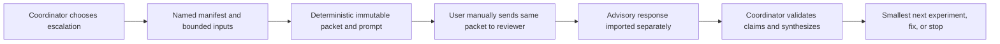

# Diagnostic escalation and review packets

Escalation is opt-in. GUI / Coordinator may use it after useful work leaves
several plausible causes, conflicting evidence, weakly documented behavior, a
costly next experiment, repeated rediscovery, cross-domain symptoms, or a
material decision that benefits from an assumption challenge. A simple
reproducible defect, one likely decisive check, mechanical work, or missing
decisive user evidence usually does not benefit. Attempt count and token count
alone are not triggers.

The external reviewer receives a bounded, immutable snapshot and is advisory.
GUI / Coordinator owns scope, technical decisions, validation, synthesis and
acceptance. The reviewer does not edit project state, Issues, game files or
task status. Do not request private chain-of-thought. Validate CK3 claims using
the project source hierarchy before promoting them to project evidence.

## Manual cycle

1. Coordinator decides whether the escalation gate is met and freezes a named
   input manifest with an explicit timestamp and evidence cutoff.
2. Run `python3 scripts/diagnostic_review.py preview --root . --manifest
   <manifest> --output .codex-sync/diagnostics/<review-id>` to inspect the
   packet hash without writing artifacts.
3. Run `build` with the same arguments. The helper creates private
   `manifest.json`, `PACKET.md`, `REVIEW_PROMPT.md`, and `IDENTITY.json` once.
   The output directory name must equal `review_id`. A repeated build refuses
   overwrite. Run `validate` before transfer.
4. User manually supplies the exact packet and prompt to one or more reviewers.
   For multiple reviewers, use identical packet bytes and withhold earlier
   responses until all reviews return.
5. Coordinator explicitly imports each supplied response with
   `import-response --root . --output .codex-sync/diagnostics/<review-id>
   --response <named-response-file> --reviewer <label>`. Imported text is
   untrusted and appended separately; it is never run or merged into the
   immutable packet. Coordinator writes any synthesis manually.

Imported replies may contain unsafe claims or instructions. Treat them as
advisory text, compare them against the packet and source hierarchy, reject
repeated experiments, and preserve uncertainty. External usage or cost that
the surface does not expose is unavailable, not zero. Do not claim savings
until measured.

Keep a small manual note beside the packet: whether escalation was used,
packet byte size, completed-experiment count, recommended new-experiment count,
whether review prevented a duplicate or changed the next action, and the
external model/surface only if explicitly known. Mark unavailable telemetry
as unavailable. Record payload revision/hashes or receipts in the repository,
build or evidence fields where relevant; state NOT APPLICABLE otherwise.

Coordinator synthesis checks the actual unresolved question, rejects repeated
experiments, reconciles external claims with target-build evidence and accepted
ADRs, and chooses one smallest useful experiment, source check, justified fix
or explicit stop/unresolved state. Keep persuasive interpretations as inference
until independently supported; disagreement between reviewers preserves
uncertainty.

## Packet format `diagnostic-review/1`

The synthetic schema below is the complete top-level shape. `inputs` are
explicit named files with either bounded 1-based `lines` or selected
`json_fields` (dot-separated object/array selectors). The helper records source
and extracted SHA-256, selector and evidence class. Missing required sources
fail; a genuinely missing optional source is emitted as `UNAVAILABLE`. Optional
inputs with unsafe paths, symlinks (including dangling symlinks), malformed
files or size/type violations fail closed. Input ordering is canonical by ID.
Existing upstream status fields are copied literally when selected; the helper
does not infer a stronger verdict.

```json
{
  "schema": "diagnostic-review/1",
  "review_id": "sample-01",
  "parent": "T-015 / #41",
  "timestamp": "2026-10-24T12:00:00Z",
  "cutoff": "2026-10-24T11:59:00Z",
  "repository": "sample revision / dirty-state note",
  "build": "CK3 build or NOT APPLICABLE",
  "problem": "Expected, actual, reproduction context, impact, unresolved decision.",
  "architecture": "Minimum accepted architecture and invariants.",
  "evidence": ["VERIFIED — bounded source fact; path and limit."],
  "experiments": ["E-01 — hypothesis; change/test; result; interpretation; limit; evidence."],
  "hypotheses": ["H-01 OPEN — support, weakening evidence and confidence limit."],
  "contradictions": ["Exact conflicting claims and their provenance."],
  "constraints": ["Do not repeat E-01; preserve accepted ADR semantics."],
  "question": "What is the smallest discriminating next experiment?",
  "inputs": [
    {"id": "evidence-01", "path": "docs/tasks/example.md", "class": "VERIFIED",
     "selector": {"lines": [1, 2]}, "required": true}
  ]
}
```

Classes are `VERIFIED`, `OBSERVED`, `INFERRED`, and `UNKNOWN`. Put the actual
experiment ledger, hypotheses, contradictions, non-repeat rules and upstream
limits in the manifest; source excerpts alone do not substitute for that
curation. Never use whole logs, chat exports, broad repository discovery,
absolute private paths, credentials or unrelated user data. The common-value
scanner is a guardrail, not proof of privacy; inspect the packet before
transfer. Review packets and responses remain under ignored `.codex-sync/`.

The sole reusable reviewer instruction source is
[DIAGNOSTIC_REVIEW_PROMPT.md](DIAGNOSTIC_REVIEW_PROMPT.md). The helper reads
its exact bytes (at most 64 KiB) from the repository containing the trusted
helper, never from the caller's packet root. Missing, symlinked, nonregular or
oversized resources fail before output directories/artifacts are created;
there is no fallback prompt. Existing packets validate against their own
stored prompt hash, without rereading or regenerating the current resource.



## Boundaries and limits

The helper rejects traversal, symlinked roots/inputs/output directories,
unsafe or mismatched review IDs, malformed identity records, oversized
sources/excerpts, common credential/email/home-path patterns and packet
overwrite. Imported review files use exclusive creation, so existing entries
including dangling symlinks cannot redirect or overwrite a write. Source
excerpts and replies are wrapped in a Markdown fence longer than any fence in
their contents. Preview performs no writes. Hash checks detect ordinary
tampering; they do not establish authenticity against a hostile local writer.
No external service is called. Human privacy review remains required before
transfer.
