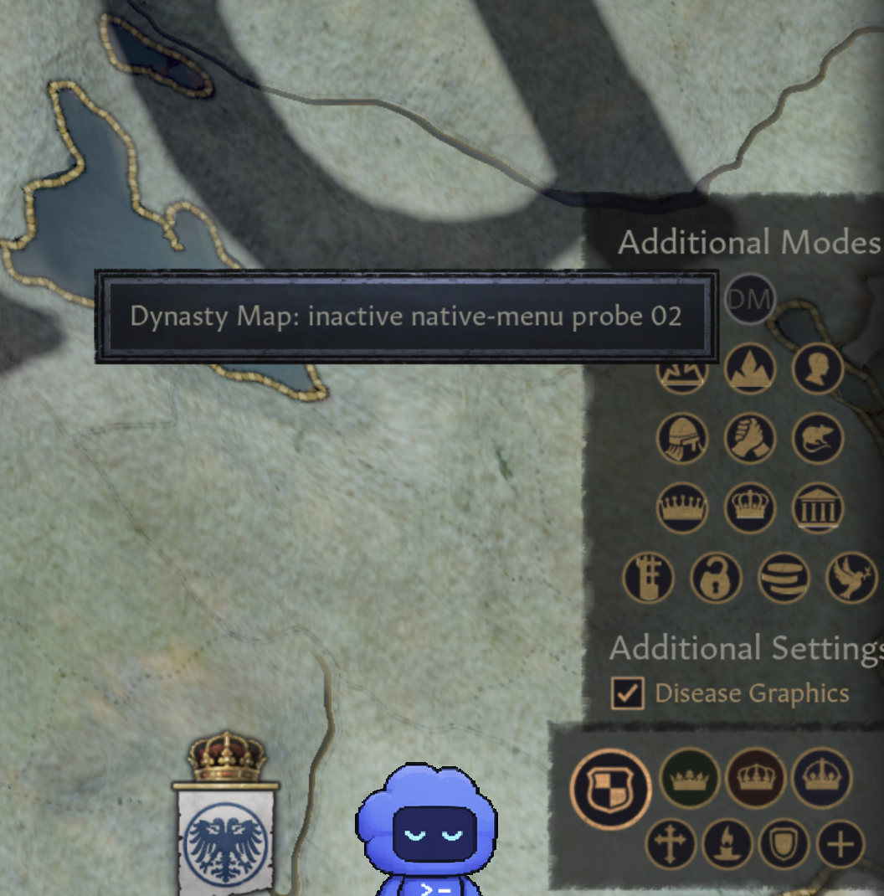

# R-010 probe 02 — native-menu visual checkpoint

2026-10-20; CK3 1.20.1.1 (Crozier), Steam build 25913294; macOS 26.5.2,
arm64. Playset Dynasty Map - GUI Probe; only local probe 0.0.0 enabled;
Garments of the Holy Roman Empire mounted. Exact save/bookmark not recorded.
Source and installed GUI match SHA-256
`6bb3dfce4d508989ffd2cf41345b6f56c71d81de725ea739f4c2629466ac2121`.

[Probe source/procedure](../../../research/probes/native-menu-alternative/README.md)
uses an original scoped submenu replacement deriving from primitive
flowcontainer. It contains no same-name inheritance or vanilla file copy.
Original minimal GUI replacement is observed working in this configuration;
this does not establish general type-resolution/namespace/load-order semantics.

## Evidence and acceptance limits

| Check | Observed result |
|---|---|
| Startup | User confirmed main menu; fresh runtime reads probe 02; startup error and GUI-warning logs empty. |
| Native-menu placement | User-supplied screenshot shows DM within Additional Modes above native rows, not in a standalone overlay. |
| Tooltip | Screenshot displays the probe-02 tooltip associated with DM. |
| Existing controls | Native icon rows and Disease Graphics remain visible in the crop; basic native-mode operations were user-confirmed, but settings operations and all DLC-specific cases were not individually verified. |
| Inert behavior | Source has enabled=no and no DM onclick; screenshot shows subdued styling. User reported clicks do not change the map; no agent-observed click-event trace claimed. |
| In-game logs | gui_warnings.log is 0 bytes; error.log is 17,413 bytes at capture, with tutorial and court-scene invalid-character messages. No probe filename/ResolveTypes match in inspected log; absence is not proof of no indirect effects. |
| Basic interaction smoke | User confirmed native mode switching/return and menu open/close work after the requested check; also reported DM clicks do not change the map. No automated click trace or exact repetition count captured. |
| Faith sub-mode smoke | User confirmed controls are visible after selecting Faith and can be switched, in response to the switch/return check. No screenshot or exact sub-mode sequence recorded. |
| Broader mini-menu / UI-scale regressions | Expanded mini-menu contents, all variants/DLC cases and another UI scale remain pending. |
| Player safety, manual refresh and color restoration | Not implemented/tested; unrelated gates remain open. |

The image is supplied by the user and cropped to the menu; no new screenshot
of the rest of the HUD is claimed. Raw in-game logs/config are archived under
ignored local/evidence/native-menu-probe-02/in-game-01. A matched-save vanilla
comparison is needed for error attribution; existing error.log is not declared
clean. No crash/recovery or full removal test for probe 02 has been completed.

## Loading-order observation

Actual startup log reads the root-level zz-prefixed probe file at :1027 and
shared/mapmodes.gui at :1587. Thus the filename did **not** move it after the
shared vanilla file. The visible marker proves this attempt took effect in this
run, not that later files win or zz naming is necessary. Avoid such a claim.

## Next checkpoint

Basic interaction smoke was confirmed by the user; fresh log sizes/content
remain unchanged (GUI warnings 0 bytes, errors 17,413 bytes, no probe-name match).
Faith sub-mode switching was subsequently user-confirmed; expanded mini-menu
contents and another UI scale still need coverage before declaring UI parity. R-010 remains open because dependable refresh, unavailable state
and lifecycle behavior are unverified. Next task is R-005 read-only player/context
research; broader GUI regression remains pending. This record is included in
the probe-02 history snapshot, published on research/native-menu-alternative
after explicit authorization; no probe code merged into main.

## Faith sub-mode follow-up

User confirmed Faith sub-mode visibility and switching/return in the current
configuration. This is positive user-reported smoke evidence for the 1.20-style
controls, not a full regression suite or proof of a future Dynasty sub-mode group.
Fresh capture: error.log remains 17,413 bytes, gui_warnings.log 0 bytes;
debug/game logs grew. Raw capture is local/ignored under
native-menu-probe-02/faith-submodes-01. No new screenshot captured. Explicit
expanded mini-menu contents and alternate UI-scale coverage remain unverified.

[Reviewed diagnostic excerpts and raw-capture checksums](reviewed-log-excerpts.txt).
