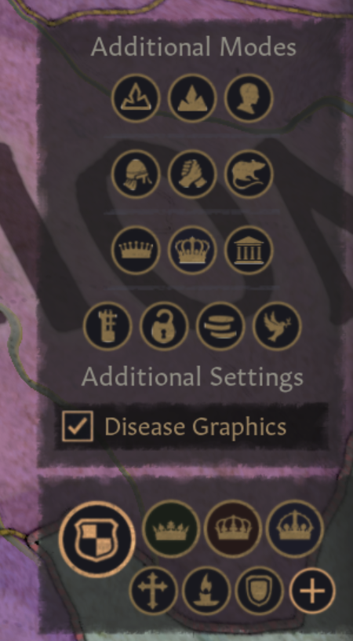
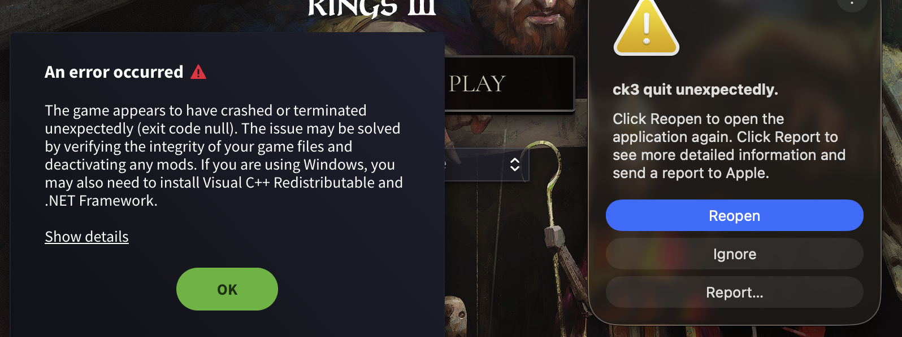

# R-010 native-menu prototype: failed launch and vanilla recovery

Date: 2026-10-20 (Europe/Warsaw). Related issue:
[R-010 / #10](https://github.com/mhaduk/ck3-dynasty-map/issues/10).

## Environment and scope

CK3 1.20.1.1 (Crozier), Steam build 25913294; macOS 26.5.2 (25F84), arm64.
The supplied macOS report identifies model Mac16,10. Steam branch UNKNOWN.
Garments of the Holy Roman Empire mounted; debug/develop launch flags configured.
Test playset: Dynasty Map - GUI Probe, containing only Dynasty Map - Native Menu
Probe 0.0.0. Realm Ledger was off. No save/bookmark was reached in the failed
launch. No CK3 Tiger run (tool unavailable).

The user authorized one inert button inside the existing Additional Modes menu.
No new map definition, title, classifier, variable or color effect was present.
Original source is retained, disabled, under
[research/probes/native-menu/failed](../../../research/probes/native-menu/failed/dynmap_native_menu_probe.gui.disabled).
SHA-256: `dc572d67794fa5d17bda7100c8f282f1ba31228991414111db84ce3221e277f0`.

## Procedure and result

1. Archived the current clean test-game logs locally before enabling the probe.
2. Launcher generated machine-local descriptors; copied only the original GUI
   into the local test mod and selected its separate playset.
3. User launched once. At 13:00:31 the process crashed before main menu.
4. Archived raw launch logs and the supplied macOS report locally/ignored.
5. Quarantined installed and original GUI as .gui.disabled. Selected No mods;
   mod-load configuration verified empty. Vanilla files were never modified.
6. User confirmed successful vanilla startup. Fresh 13:09 launch log lists no
   mods and the expected DLC; error.log was empty at inspection.

**Observed failure:** stack exhaustion with extensive recursive
CPdxGuiFactory::ResolveTypes calls. **Strongly supported inference:** the tested
same-name script-defined type/base resolved cyclically rather than decorating
the existing menu. This rejects this attempt; it does not prove every original
native-menu integration mechanism impossible. No second crash run was attempted.
Successful vanilla startup is recovery evidence, not a full save/removal test.

## Reviewed evidence

- [Selected log and crash-report excerpts](reviewed-log-excerpts.txt): compact
  relevant lines plus explicitly labelled observations; no full raw dumps,
  account identifiers, incident identifiers or absolute local paths.
- Target menu screenshot below: user-provided vanilla menu, **before** the probe;
  it is not evidence that the DM button appeared.
- Crash screenshot below: user-provided launcher/macOS dialogs from the failure.

## Disposition

R-010 remains open; this native-menu extension route is withdrawn. Do not
install the failed source. Research a materially different original mechanism
before another probe; no vanilla GUI copy or standalone overlay is approved.
Main menu recovery was user-observed and corroborated by local logs; no recovery
screenshot, repeated-menu test, UI-scale test or functional map test was captured.
Raw logs, crash report and recovery capture remain under ignored local/evidence.
Only the reviewed excerpts and these selected screenshots belong in Git.
